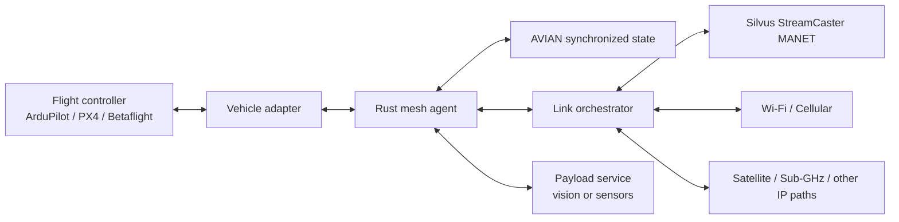

# AVIAN v0.1 architecture

## Design objective

The mesh must continue operating when the ground station disappears, any
aircraft crashes, or connected groups become temporarily partitioned. No node
owns unique operational state and no permanent leader is assumed.

The mesh agent is the only process that handles mesh identity, command
verification, state synchronization, and transport policy. Vision and other
payload services are isolated local processes so their failure cannot take
down telemetry or emergency control.

## Node roles

Roles describe capabilities, not authority:

- ArduPilot and PX4 aircraft advertise telemetry, mission navigation,
  emergency control, relay, and optional payload capabilities.
- Betaflight aircraft advertise telemetry, emergency control, and relay. They
  never advertise autonomous mission navigation.
- Ground and cloud nodes are regular peers. Losing them does not invalidate
  state held by aircraft.
- Relay responsibility is selected dynamically from current connectivity and
  resources. It is not a permanent leadership role.

## Data paths

| Data | Behavior |
| --- | --- |
| Emergency command and acknowledgement | Signed, short-lived, replay-protected, sent redundantly |
| Mission intent and detections | Durable AVIAN state; reconciled after partitions |
| Position and health telemetry | Latest-value, short-lived, source-rate-limited; relay-critical and attention changes bypass routine limits |
| Operator swarm state | Compact rotating summaries; no permanent reporting drone and no full position feed by default |
| Images and logs | Durable, resumable, opportunistic |
| Video | Separate streaming path; never placed in the replicated record store |

## Altitude model

The system-wide planning ceiling is 30,000 ft MSL (9,144 m). Messages retain three
different measurements rather than treating them as interchangeable:

- `msl_m`: altitude above mean sea level; used for the system ceiling.
- `agl_m`: estimated height over terrain; used for terrain and RF geometry.
- `above_launch_m`: displacement from the launch reference.

Every aircraft can advertise a lower platform ceiling. The task allocator must
honor the lower of the system and platform ceilings.

Link scoring combines measured latency, loss, goodput, signal quality,
stability, energy cost, estimated line of sight, and Fresnel clearance. A high
altitude never makes a link healthy by itself.

## Transport boundary

`mesh-transport` owns the AVIAN replication protocol over Iroh QUIC and stores
versioned records transactionally in redb. Peers compare record inventories and
request bounded batches, including records received through other neighbors.
Reconnection therefore reconciles partitions without a ground coordinator.
Conflicts on one record ID use a deterministic whole-record ordering; this is
record reconciliation, not field-level document merging. Routine telemetry
reuses stable record IDs so new samples replace previous values. Commands use
distinct record IDs and retain their signed, expiring application envelopes.

Peers prove possession of a shared formation key with nonce-bound authentication
before exchanging records. Each endpoint identity is stable across restarts
because it is derived from the formation secret and unique node name. Public
Iroh relays are disabled; initial peers are supplied as endpoint/address lists.
One AVIAN identity can have several ordered IP addresses, allowing reconnects
over different radio underlays without changing AVIAN identity. See the
[transport upgrade guide](transport-upgrade.md) before upgrading a provisioned
formation.

The UAV link orchestrator remains responsible for altitude-aware scoring,
hysteresis, path changes, and per-message redundancy because those are
application-specific decisions. AVIAN synchronization is independent of any
ground or cloud peer.

## Traffic control

Every companion applies the shared traffic policy before it publishes routine
telemetry or radio observations, limiting traffic independently of the active
underlay. Failsafe and state transitions pass immediately. A rotating bounded
set of peers publishes compact operator summaries, so the normal operator
feed is not 200 simultaneous detailed drone streams. See [traffic
management](traffic-management.md).

## Silvus boundary

AVIAN treats a Silvus StreamCaster network as an IP MANET underlay. Silvus
handles RF neighbor formation and packet routing; AVIAN handles vehicle
identity, application state, delivery semantics, and the bounded logical
overlay. This avoids stacking a 200-node AVIAN full mesh on top of a radio
mesh that already routes packets.

Silvus is a preferred path, not a required dependency. A peer descriptor may
carry a Silvus address followed by Wi-Fi, cellular, or other reachable
addresses. AVIAN receives the complete list whenever the agent connects or
reconnects. CHUD owns physical radio configuration; the AVIAN radio plugin
validates and distributes planning intent and observations. ARC presents the
operator workflow. Live score-driven make-before-break handoff
remains future work. See [the Arc radio-plugin guide](arc-radio-plugin.md).

## Swarm topology

AVIAN supports formations from 5 through 200 aircraft. A deterministic,
leaderless planner gives each node at most eight direct AVIAN neighbors. It
combines a ring with progressively longer chords, so connection and sync work
grow linearly with formation size instead of creating an all-to-all graph.
Every node given the same versioned membership view computes the same symmetric
overlay; no node is assigned authority by the planner.

The agent can load a shared membership manifest, validate its local AVIAN
identity, and select only its planned neighbors. Live distribution and
reconciliation of membership generations is a later milestone. See
[the scalability contract](scalability.md).

## Mission relay corridors

Before a beyond-direct-link mission, ARC UI can submit base/objective geometry,
the available aircraft inventory, radio assumptions, and an automatic or
manual relay allocation. Automatic coverage is either `minimum` (one relay
broadcaster at each required station) or `maximum` (an active broadcaster and
a Bluetooth-coordinated receiving standby at every station). AVIAN returns
exact reserved members, remaining payload capacity, hop utilization, failure
tolerance, and warnings. Accepted plans are versioned mission allocations;
roles describe work for that mission and do not create permanent authority.

The current pre-mission corridor is a straight geodesic path. During a mission,
the leaderless in-flight relay planner consumes shared, fresh bidirectional
link observations and current aircraft positions. It forms a relay group only
when a complete observed path meets the mission-specific health policy; if
range is unknown or a path disappears, it asks for measured discovery rather
than guessing an unobserved hop. Terrain-aware routing, radio-statistics
collection, and physical station-hold/backfill execution remain integration
stages. See [the ARC UI relay-planning guide](arc-ui-relay-planning.md).

For maximum coverage, live planning also requires a distinct Bluetooth-linked
standby for every active relay. The standby must have current non-Bluetooth
links to the same neighboring hops, not merely a nearby Bluetooth peer. This
keeps both aircraft ready to receive while the active radio alone broadcasts;
the local heartbeat handover changes that role on an active-peer failure.

The onboard `mesh-agent` can evaluate a shared runtime configuration at a
bounded cadence. It reads latest telemetry and link observations from AVIAN,
rebuilds the dynamic candidate inventory, and publishes state-changing relay
decisions under its own record ID. The configuration does not create a leader;
other companions evaluate the same policy and records independently.

## Flight-controller telemetry boundary

ArduPilot and PX4 are decoded through the MAVLink common dialect. AVIAN locks
an adapter to the system ID of the first matching flight-controller heartbeat,
then combines `GLOBAL_POSITION_INT`, `ATTITUDE`, `ALTITUDE`, `SYS_STATUS`,
`RC_CHANNELS`/`RADIO_STATUS`, and `EXTENDED_SYS_STATE` into one normalized
record. Messages from other MAVLink systems on the same network are ignored.

`relative_alt` remains above-home altitude; it is never treated as AGL.
Unknown protocol sentinel values remain absent in AVIAN telemetry.

## Failure model

The first simulation validates:

1. Aircraft receive a mission while connected to the ground node.
2. The ground node is partitioned and the aircraft continue sharing telemetry.
3. One aircraft crashes without halting the remaining component.
4. A degraded primary transport is replaced by a healthier path.
5. The ground node reconnects and sends a signed Betaflight emergency command.
6. A recovered aircraft converges to the current mission and telemetry state.
